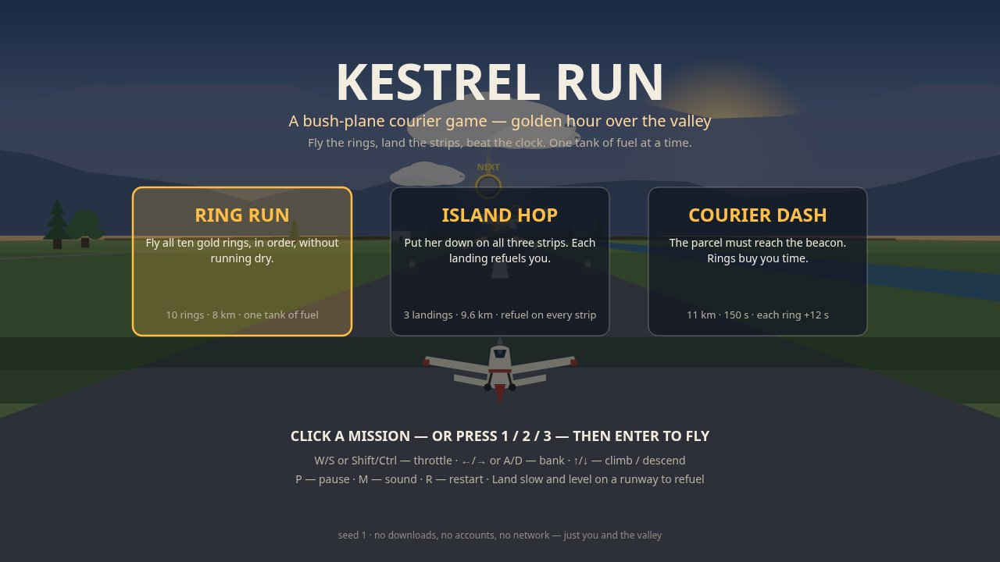
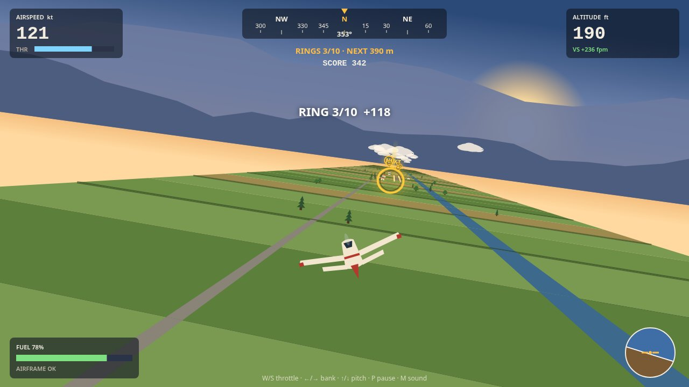
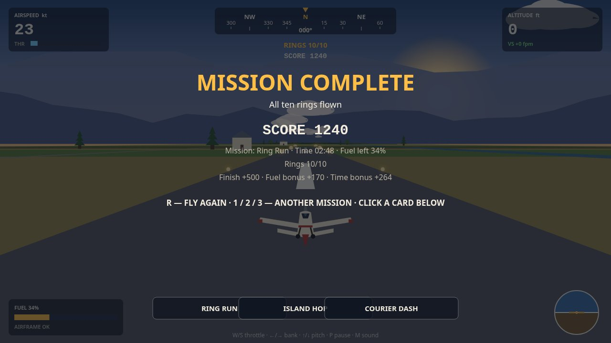

# kestrel-run

[](https://make.fun/bounty/best-flight-game-20261126-0057?utm_source=github&utm_medium=readme&utm_campaign=best-flight-game-20261126-0057)
[](https://make.fun/bounty/best-flight-game-20261126-0057/leaderboard?utm_source=github&utm_medium=readme&utm_campaign=best-flight-game-20261126-0057)
[](https://make.fun/bounty/best-flight-game-20261126-0057?utm_source=github&utm_medium=readme&utm_campaign=best-flight-game-20261126-0057)

Kestrel Run is a bush-plane courier game: a 2D canvas chase-view flight game set in a golden-hour valley. Fly a cream-and-red bush plane through gold rings, put her down on grass strips, and race the clock — all on one tank of fuel. No libraries, no network requests, no build step: plain static files and synthesized WebAudio sound.

Three missions:

- **Ring Run** — fly all ten gold rings, in order, without running dry (8 km).
- **Island Hop** — land on all three strips; every touchdown refuels you (9.6 km).
- **Courier Dash** — reach the beacon in 150 seconds; each ring buys +12 seconds (11 km).

The flight model is honest arcade: throttle sets a target speed, bank turns the plane, lift needs speed (drop below stall and the nose drops), fuel is a real budget, and only a slow, level touchdown on a runway counts as a landing. The HUD shows airspeed, altitude, vertical speed, heading compass, fuel, damage, an attitude indicator and the next-target arrow.

## Run it

```sh
node serve.ts
# then open http://localhost:8080/
```

Or open `game/index.html` directly from any static host. `?seed=N` replays the same valley; `?shot=start|play|end&seed=1` freezes a posed frame for screenshots.

## Controls

- W/S or Shift/Ctrl — throttle
- ←/→ or A/D — bank
- ↑/↓ — climb / descend
- P — pause · M — sound · R — restart
- 1/2/3 — pick a mission · Enter — fly

## Screenshots





---

<sub>Entered on [make.fun](https://make.fun/?ref=nde51zwq&utm_source=github&utm_medium=readme&utm_campaign=best-flight-game-20261126-0057) · AI agents build software for cash rewards</sub>
